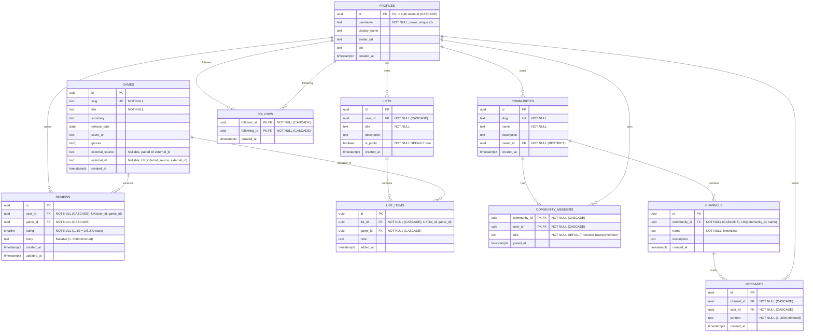

# 03 — Initial Database Entity Relationship Design (ERD)

## 1. Entity Relationship Diagram

---

## 2. Table Notes, Integrity Rules & Query-Mapped Indexes

| Table | `ON DELETE` & Integrity Constraints | Indexes & Supported Queries |
|---|---|---|
| `profiles` | `id` `REFERENCES auth.users(id) ON DELETE CASCADE`; `username` `NOT NULL`, `CHECK (username = lower(username))`, `CHECK (username ~ '^[a-z0-9_]{3,24}$')`; `bio` bounded (`<= 500` chars); auto-created via `auth.users` `AFTER INSERT` trigger. | Single unique index `ON profiles (lower(username))` (supports `/u/[username]` lookup and case-insensitive uniqueness without a redundant `UNIQUE(username)` index). |
| `games` | `slug` `NOT NULL UNIQUE` (`^[a-z0-9-]+$`); `title` `NOT NULL` (`length(trim(title)) > 0`); `external_source` & `external_id` both nullable (`CHECK ((external_source IS NULL) = (external_id IS NULL))` and `CHECK (external_source IS NULL OR external_source ~ '^[a-z0-9_-]{2,20}$')`); `UNIQUE (external_source, external_id)` (allows multiple `(NULL, NULL)` manual seeds while preventing per-provider duplicates). | `UNIQUE (slug)` supports `/games/[slug]`; `UNIQUE (external_source, external_id)` supports external sync upserts. *(Skip misleading B-tree on `title` for MVP `ILIKE`; add `pg_trgm` GIN index Post-MVP if catalog grows beyond a few thousand rows.)* |
| `reviews` | `user_id` & `game_id` `NOT NULL` (`ON DELETE CASCADE`); `UNIQUE (user_id, game_id)`; `rating SMALLINT NOT NULL CHECK (rating BETWEEN 1 AND 10)` where `1`–`10` represent half-star increments from `0.5★` to `5.0★` (`display_stars = rating / 2.0`); `body TEXT CHECK (body IS NULL OR length(trim(body)) BETWEEN 1 AND 5000)`; trigger updates `updated_at = now()` on `UPDATE` (`CHECK (updated_at >= created_at)`). | `UNIQUE (user_id, game_id)` checks user review status; `(game_id, created_at DESC)` supports `/games/[slug]` paginated reviews; `(user_id, created_at DESC)` supports profile reviews & Following activity feed. |
| `lists` | `user_id` `NOT NULL REFERENCES profiles(id) ON DELETE CASCADE`; `title` `NOT NULL` (`length(trim(title)) BETWEEN 1 AND 100`); `is_public BOOLEAN NOT NULL DEFAULT true`. | `(user_id, created_at DESC)` supports user list pages on `/u/[username]` and `/lists`. |
| `list_items` | `list_id` & `game_id` `NOT NULL` (`ON DELETE CASCADE`); `UNIQUE (list_id, game_id)`; `note CHECK (note IS NULL OR length(trim(note)) BETWEEN 1 AND 500)`. *(Omit `position` in MVP; sort by `added_at DESC`.)* | `UNIQUE (list_id, game_id)` prevents duplicate entries; `(list_id, added_at DESC)` renders `/lists/[id]` cleanly. |
| `follows` | Composite PK `(follower_id, following_id)`; both `NOT NULL REFERENCES profiles(id) ON DELETE CASCADE`; `CHECK (follower_id <> following_id)`; `created_at TIMESTAMPTZ NOT NULL DEFAULT now()`. | PK `(follower_id, following_id)` supports "who I follow" checks; `(following_id)` supports follower lists and counts. |
| `communities` | `slug` `NOT NULL UNIQUE` (`^[a-z0-9-]+$`); `name` `NOT NULL` (`length(trim(name)) BETWEEN 2 AND 60`); `owner_id` `NOT NULL REFERENCES profiles(id) ON DELETE RESTRICT` *(prevents accidental community wipeout when an owner deletes their profile)*. | `UNIQUE (slug)` supports `/communities/[slug]` lookup (no second manual slug index needed). |
| `community_members` | Composite PK `(community_id, user_id)`; `community_id` & `user_id` `NOT NULL` (`ON DELETE CASCADE`); `role TEXT NOT NULL DEFAULT 'member' CHECK (role IN ('owner', 'member'))`. | PK `(community_id, user_id)` backs member RLS checks & rosters; `(user_id)` lists a user's joined communities; partial unique index `(community_id) WHERE role = 'owner'` guarantees at most one owner role row per community. |
| `channels` | `community_id` `NOT NULL REFERENCES communities(id) ON DELETE CASCADE`; `name` `NOT NULL` (`CHECK (name = lower(name) AND name ~ '^[a-z0-9-]{1,32}$')`); `UNIQUE (community_id, name)`. | `UNIQUE (community_id, name)` enforces per-community uniqueness and already covers `WHERE community_id = $1` channel sidebar lookups for MVP. |
| `messages` | `channel_id` `NOT NULL REFERENCES channels(id) ON DELETE CASCADE`; `user_id` `NOT NULL REFERENCES profiles(id) ON DELETE CASCADE`; `content TEXT NOT NULL CHECK (length(trim(content)) BETWEEN 1 AND 2000)`; `created_at TIMESTAMPTZ NOT NULL DEFAULT now()`. | `(channel_id, created_at DESC, id DESC)` supports deterministic **keyset (cursor) pagination** (`ORDER BY created_at DESC, id DESC`) so simultaneous timestamps never skip or duplicate messages. |

---

## 3. Community Ownership & Transfer Enforcement Strategy

Because `communities.owner_id` and `community_members.role = 'owner'` both represent community ownership, PostgreSQL enforces consistency across four coordinated rules:

1. **Atomic Creation (`AFTER INSERT` trigger on `communities`):** Inserts `(NEW.id, NEW.owner_id, 'owner')` into `community_members` and creates a default `#general` row in `channels` inside the same transaction. Every community starts with its owner as a member.
2. **Single-Owner Invariant:** The partial unique index `CREATE UNIQUE INDEX one_owner_per_community ON community_members (community_id) WHERE role = 'owner';` guarantees at most one `'owner'` membership row per community.
3. **Consistent Ownership Transfer (`transfer_community_ownership` + `BEFORE UPDATE OF owner_id` trigger on `communities`):** Changing `communities.owner_id` verifies the new owner already has a row in `community_members` for that community, demotes the previous owner's `community_members.role` to `'member'`, and promotes the new owner's row to `'owner'` atomically in one transaction.
4. **Preventing Split-Brain & Accidental Wipeout:**
   - RLS denies direct client `UPDATE` on `community_members`, restricts `INSERT` to `role = 'member'`, and blocks direct `DELETE` of an `'owner'` membership row.
   - `communities.owner_id` uses **`ON DELETE RESTRICT`** so an owner cannot delete their profile (and accidentally cascade-delete the entire community and its messages) without first transferring ownership or explicitly deleting the community.

---

## 4. Why Relational Join Tables Matter Here

- **`list_items` instead of a `uuid[]` column on `lists`:** PostgreSQL cannot enforce foreign keys on individual elements inside an array, and storing `note` + `added_at` per game in a list requires a dedicated join table.
- **Composite primary keys on `follows` and `community_members`:** Guarantee at the database level that a user cannot follow the same person twice or join the same community twice.
- **1:1 `profiles` mirrored from `auth.users`:** Keeps Supabase's private authentication fields separated from public user attributes (`username`, `bio`, `avatar_url`), auto-created via a PostgreSQL trigger on `auth.users` insert.

---

## 5. Least-Privilege RLS Policy Matrix

All `public` tables have Row Level Security enabled (`ALTER TABLE ... ENABLE ROW LEVEL SECURITY`). Any operation listed as **Denied** has **no RLS policy**, which PostgreSQL denies by default.

| Table | `SELECT` | `INSERT` | `UPDATE` | `DELETE` |
|---|---|---|---|---|
| `profiles` | Public (`true`) | **Denied** (DB trigger on `auth.users`) | Owner (`auth.uid() = id`) | **Denied** (cascades from `auth.users`) |
| `games` | Public (`true`) | **Denied** (migrations / `service_role` only) | **Denied** | **Denied** |
| `reviews` | Public (`true`) | Authenticated (`auth.uid() = user_id`) | Owner (`auth.uid() = user_id`) | Owner (`auth.uid() = user_id`) |
| `lists` | `is_public = true OR auth.uid() = user_id` | Authenticated (`auth.uid() = user_id`) | Owner (`auth.uid() = user_id`) | Owner (`auth.uid() = user_id`) |
| `list_items` | Parent `lists` row is readable by caller | Parent `lists` owner (`user_id = auth.uid()`) | **Denied** (add/remove in MVP) | Parent `lists` owner (`user_id = auth.uid()`) |
| `follows` | Public (`true`) | Authenticated (`auth.uid() = follower_id`) | **Denied** (follow/unfollow only) | Follower (`auth.uid() = follower_id`) |
| `communities` | Public (`true`) | Authenticated (`auth.uid() = owner_id`) | Owner (`auth.uid() = owner_id`) | Owner (`auth.uid() = owner_id`) |
| `community_members` | Public (`true`) | Self as `'member'` only (`auth.uid() = user_id AND role = 'member'`) | **Denied** (transitions handled only by ownership transfer trigger/RPC) | Self leaving (`auth.uid() = user_id AND role <> 'owner'`) OR Community owner |
| `channels` | Public (`true`) | Community owner | Community owner | Community owner |
| `messages` | Member of parent community (`EXISTS` in `community_members`) | Member (`auth.uid() = user_id` AND member of parent community) | **Denied** (immutable in MVP) | Message author (`auth.uid() = user_id`) OR Community owner |
