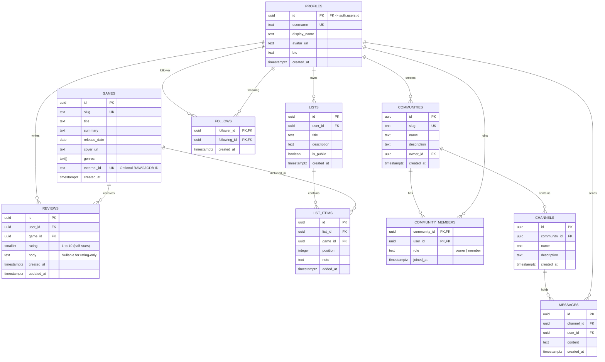

# 03 — Initial Database Entity Relationship Design (ERD)

## 1. Entity Relationship Diagram

---

## 2. Table Notes, Constraints & Indexes

| Table | Key Constraints | Recommended Indexes |
|---|---|---|
| `profiles` | `id` references `auth.users(id) ON DELETE CASCADE`; `username` unique (lowercase enforced). | Unique index on `lower(username)`. |
| `games` | `slug` unique; `external_id` unique (nullable if seeded manually). | Index / `pg_trgm` GIN index on `title` for fast search; GIN index on `genres`. |
| `reviews` | `UNIQUE (user_id, game_id)` (1 review/rating per user per game in MVP); `CHECK (rating BETWEEN 1 AND 10)`. | `(game_id, created_at DESC)` and `(user_id, created_at DESC)`. |
| `lists` | `user_id` references `profiles(id) ON DELETE CASCADE`; `is_public` defaults to `true`. | `(user_id, created_at DESC)`. |
| `list_items` | `UNIQUE (list_id, game_id)`; `list_id` & `game_id` cascade on delete. | `(list_id, position ASC)`. |
| `follows` | Composite PK `(follower_id, following_id)`; `CHECK (follower_id <> following_id)`. | `(following_id)` (PK already indexes `follower_id`). |
| `communities` | `slug` unique; `owner_id` references `profiles(id)`. | Unique index on `slug`. |
| `community_members` | Composite PK `(community_id, user_id)`; `role IN ('owner', 'member')`. | `(user_id)` to quickly list a user's joined communities. |
| `channels` | `community_id` references `communities(id) ON DELETE CASCADE`. | `(community_id, created_at ASC)`. |
| `messages` | `channel_id` references `channels(id) ON DELETE CASCADE`; `CHECK (length(trim(content)) > 0)`. | `(channel_id, created_at DESC)` for paginated chat history. |

---

## 3. Why Relational Join Tables Matter Here

- **`list_items` instead of a `uuid[]` column on `lists`:** PostgreSQL cannot enforce foreign keys on individual elements inside an array, and storing `position` + `note` per game in a list requires a dedicated join table.
- **Composite primary keys on `follows` and `community_members`:** Guarantee at the database level that a user cannot follow the same person twice or join the same community twice.
- **1:1 `profiles` mirrored from `auth.users`:** Keeps Supabase's private authentication fields separated from public user attributes (`username`, `bio`, `avatar_url`), typically auto-created via a PostgreSQL trigger on `auth.users` insert.
